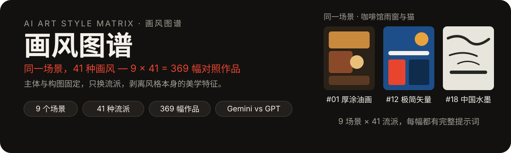
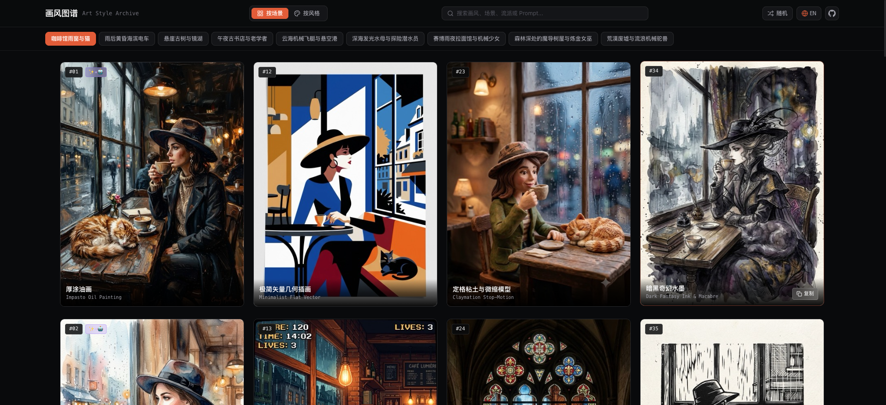

<p align="right">
  <a href="./README.md">简体中文</a> · <strong>English</strong>
</p>

<p align="center">
  
</p>

<p align="center">
  <a href="https://art-style-showcase.xiaosang.cc/"><strong>🌐 Live Demo (Primary)</strong></a> · 
  <a href="https://holynova.github.io/art-style-showcase/"><strong>🚀 Mirror (GitHub Pages)</strong></a> · 
  <a href="https://github.com/holynova/art-style-showcase"><strong>📦 GitHub Source</strong></a> · 
  <a href="https://xiaosang.cc/"><strong>✨ Portfolio</strong></a>
</p>

---

## Proof of Work

<p align="center">
  
</p>

---

## What It Is

A rigorous visual benchmark exploring classic art movements. Controls variables by fixing 9 standard benchmark scenes (urban rainy night, wild landscape, still life, etc.) while systematically rendering 41 art movements (Impressionism, Ukiyo-e, Art Deco, Bauhaus, Pop Art, Cyberpunk, etc.). Each movement carries breakdown fields for brushwork, color, technique, and masters (see data.js); the site offers browsing, a lightbox, and one-click prompt copy.

---

## Why It Matters (Key Features)

- **Benchmark Variable-Controlled Testing**: Strictly keeps scene subjects and composition consistent while swapping movement prompts to isolate aesthetic traits.
- **41 Art Movements Taxonomy**: From Impressionism and Ukiyo-e to Art Deco, Bauhaus, Risograph, and Cyberpunk.
- **Dual-Model Comparison (4-item pilot)**: Impasto and Watercolor in the Cafe and Seaside Tram scenes have ChatGPT versions; switch between Gemini / ChatGPT inside the lightbox.
- **Immersive Lightbox**: Click to enlarge the full-resolution artwork (16:9 about 1376×768, 3:4 about 896×1200), zoom in on brushwork, and copy the prompt with one click.

---

## Inventory & Scope

9 benchmark scenes, 41 art movements, 369 specimens (plus 369 thumbnails), bilingual language toggle, browse by scene or by style.

---

## Quick Start

### 1. Live Demos
Experience it directly in your browser without any setup:
- 🌐 **Primary Demo**: [https://art-style-showcase.xiaosang.cc/](https://art-style-showcase.xiaosang.cc/)
- 🚀 **Alternative Mirror (GitHub Pages)**: [https://holynova.github.io/art-style-showcase/](https://holynova.github.io/art-style-showcase/)

### 2. Local Development
Clone the repository and launch locally:

```bash
git clone https://github.com/holynova/art-style-showcase.git
cd art-style-showcase
open index.html # Pure static HTML5, open directly in browser
```

---

## License & Author

- **Author**: [holynova (Xiaosang)](https://xiaosang.cc/)
- **License**: [MIT License](./LICENSE)
- **Featured Collection**: Curated as part of [Where Craft Lives (xiaosang.cc)](https://xiaosang.cc/).
