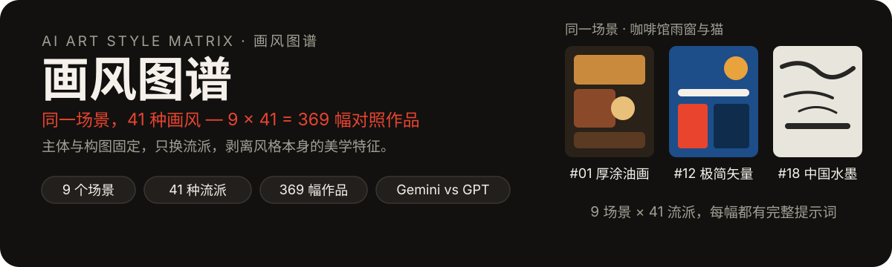
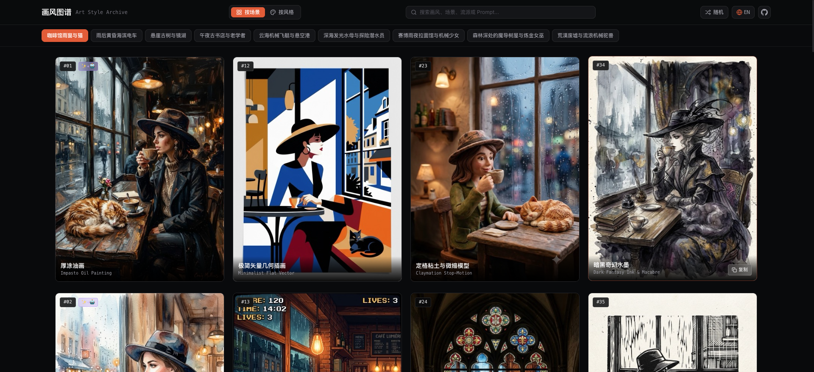

<p align="right"><a href="README.en.md">English</a></p>

<p align="center">
  
</p>

<p align="center">
  <a href="https://xiaosang.cc/art-style-showcase/">▶ 在线浏览</a>
  ·
  <a href="https://holynova.github.io/art-style-showcase/">GitHub Pages 备选镜像</a>
  ·
  <a href="https://github.com/holynova/art-style-showcase">GitHub 仓库</a>
</p>

画风图谱是用对照组思维做的艺术流派图谱：9 个基准场景（咖啡馆雨窗与猫、雨后黄昏海滨电车、悬崖古树与镜湖……），每个场景用 41 种流派各画一幅，共 369 幅。主体与构图严格固定，只换流派参数，风格本身的美学特征就被剥离出来了——同一扇雨窗，厚涂油画、水彩、浮世绘、赛博朋克各是什么样，一眼看清。

## 截图

<p align="center">
  
</p>

## 功能

- **9 个基准场景**：咖啡馆雨窗与猫、雨后黄昏海滨电车、悬崖古树与镜湖、午夜古书店与老学者、云海机械飞艇与悬空港、深海发光水母与潜水员、赛博雨夜拉面馆与机械少女、森林魔导树屋与炼金女巫、荒漠废墟与流浪机械驼兽；3:4 肖像比例。
- **41 种流派**：传统画种 13（厚涂油画、水彩、印象派、浮世绘……）、版画印刷 5、时代美学 7、现代数码 8、版画与媒介 8，覆盖印象派、Art Deco、包豪斯、波普、赛博朋克、吉卜力、像素、黏土定格等。
- **每幅都有完整提示词**：369 幅全部带英文提示词、标签、代表画家、色调与技法说明，灯箱里一键复制。
- **双模型对比**：灯箱内可切换 Gemini / ChatGPT（厚涂油画与水彩两款在咖啡馆、电车两场景有 ChatGPT 版，共 4 组）。
- **两种浏览**：按场景、按风格切换；搜索风格、场景或提示词；随机风格；中英双语切换。
- **灯箱**：放大看笔触细节，前后翻幅，移动端可用。

## 本地运行

纯静态站，零构建，直接打开 `index.html` 即可；或起一个静态服务器：

```bash
python3 -m http.server 8000
# 打开 http://localhost:8000
```

仓库约 218MB（369 幅原图 + 369 张缩略图），克隆时请注意体积。

## 技术

- 纯 HTML + CSS + JS，零构建、零运行时依赖；数据在 `data.js`（9 场景 × 41 流派，369 条，含提示词与技法字段）。
- 图片：`images/` 原图 369 张 + `images/thumbs/` 缩略图 369 张；`chatgpt_images/` 是 4 张 ChatGPT 对照版原图。
- 批量生图脚本：`gemini-batch-generator.mjs`（Gemini 批量生成）、`generate_style_visuals.py`。

```
index.html                  入口（画廊 / 灯箱 / 搜索 / 随机）
data.js                     数据集：9 场景 × 41 流派 × 提示词
style.css                   深色画廊样式
images/                     369 张原图
images/thumbs/              369 张缩略图
chatgpt_images/             4 张 ChatGPT 对照版
gemini-batch-generator.mjs  Gemini 批量生图
generate_style_visuals.py   风格视觉生成脚本
```
